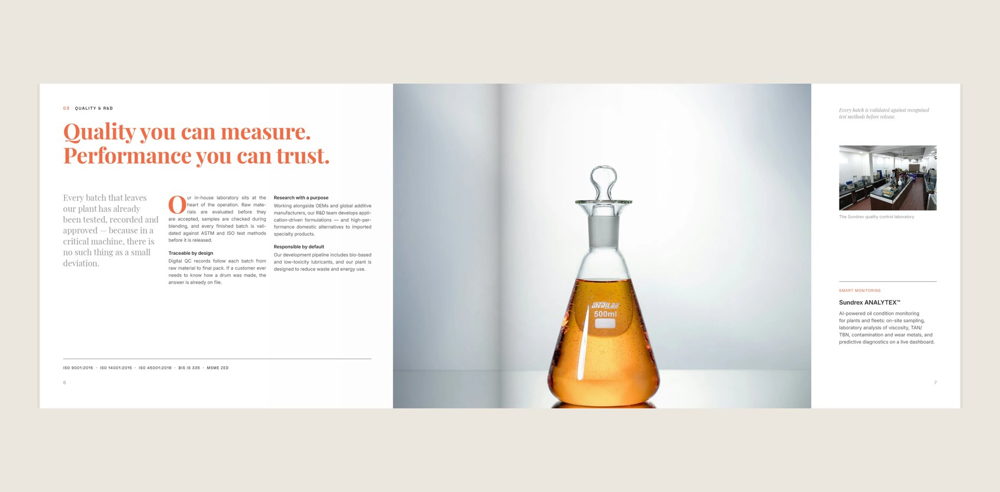

# Sundrex Corporate Brochure 2026: page-turning showcase

An interactive presentation of the Sundrex brochure (Version C) for client review. The brochure lies on a desk: drag a page to turn it, drag the brass magnifier across a spread to read the detail, or use the ← → keys. It opens from the closed front cover and ends on the closed back cover.



## Open it

Serve this folder with any static web server, then open the address it prints:

```sh
python3 -m http.server 4173
```

Then visit http://localhost:4173. Opening `index.html` directly from disk mostly works too, but fonts and images load more reliably over http.

Useful URL options:
- `?nointro`: skip the opening riffle and start on the cover
- `?shot=4`: open on a given spread (0 is the front cover, 10 is the back cover)

## Share it with the client

The site is static (one HTML file, 11 spread images and 3 font files, about 2.8 MB), so any static host works:
- **Netlify Drop:** drag this folder onto https://app.netlify.com/drop to get a link.
- **GitHub Pages:** push this folder to a repository and set Pages to deploy from the `main` branch, root folder (no build step).
- **Vercel / Cloudflare Pages:** import the folder as a static site with no build step.

It is a draft for client review, so share the link privately.

## Update the spreads after editing in InDesign

1. With the brochure open in InDesign, run `tools/export_pages.jsx`. It exports Version C pages 1–20 to `tools/pages/`.
2. Rebuild the open-book spread images:

   ```sh
   python3 tools/make_spreads.py tools/pages brochure
   ```

3. Reload the page.

The spread images are 3400 × 1676 px, with the paper inset 4% at the sides and 17% top and bottom. `index.html` uses the same proportions (`SIDE` and `PG`), so keep them in step if you change them.

## What is inside

- `index.html`: the page, styles and the page-turn and magnifier engine
- `brochure/spread-00.webp` … `spread-10.webp`: the front cover (closed), nine open spreads, and the back cover (closed)
- `brochure/fonts/`: Playfair Display and Inter (SIL Open Font License, from Google Fonts)
- `tools/`: the InDesign export script and the spread builder

## Credits

- Page-turn and magnifier engine adapted from [Meng To's Sketchbook](https://github.com/MengTo/sketchbook), which in turn builds on [Matthew Yu's personal portfolio concept](https://github.com/matthewyuart/personalportfolio).
- The Sketchbook repository does not include a licence file. Before publishing this showcase publicly or reusing it commercially, check with the author.
- Brochure photography: the client's own images and Unsplash (see `Links/stock-unsplash/credits.csv` in the brochure project).
